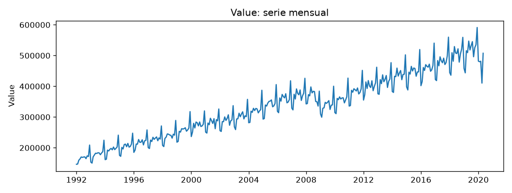
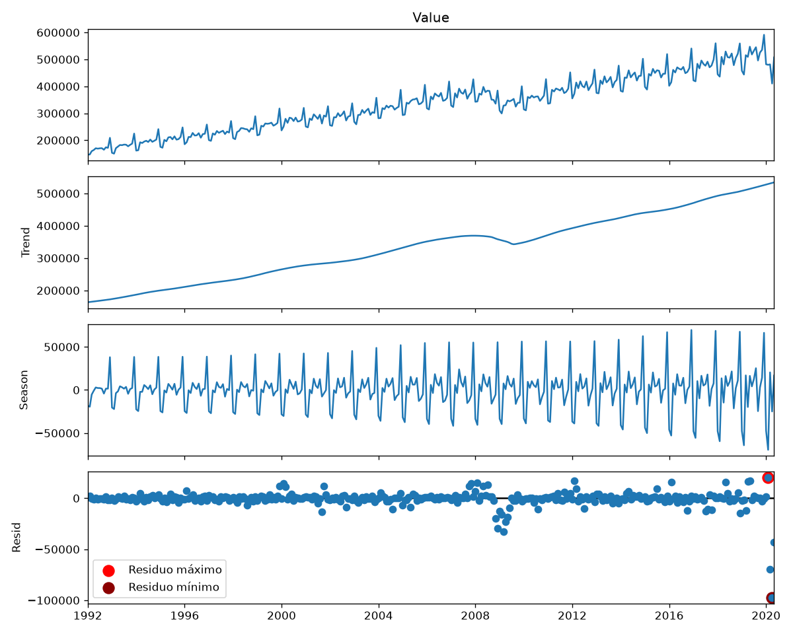
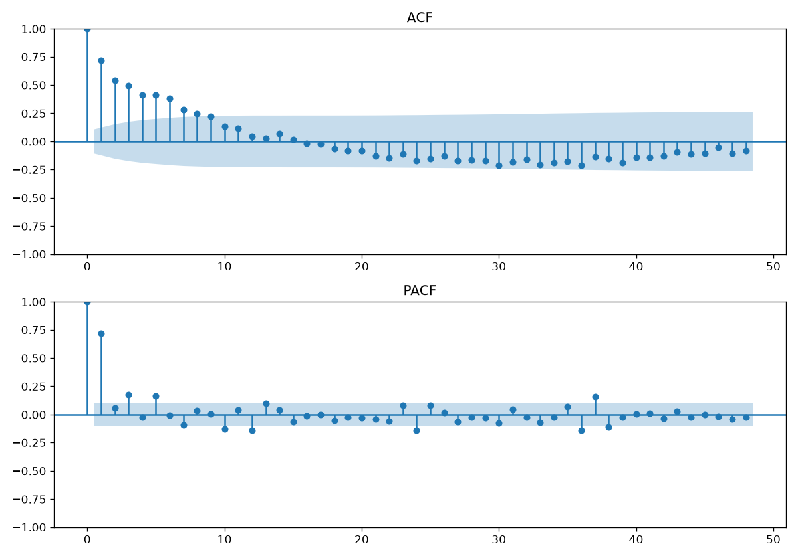
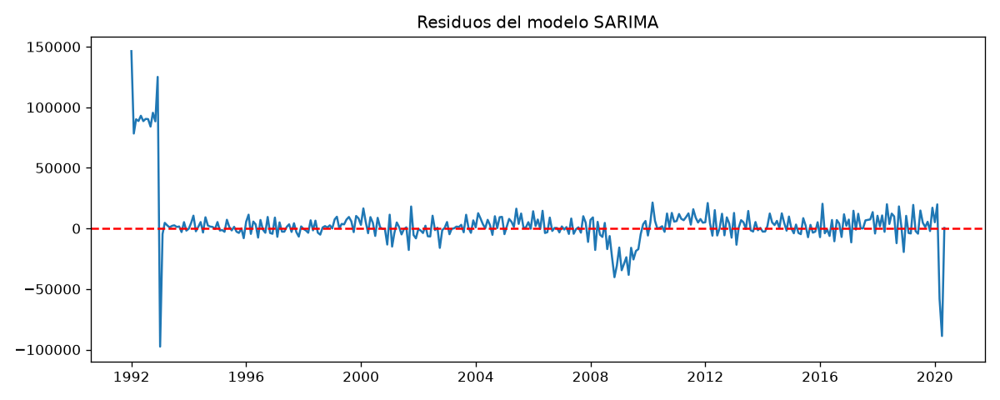

# Informe del miniproyecto 1

Llene cada sección reemplazando los marcadores `{{...}}`, sin quitar las
secciones. Las cifras salen de lo que imprime `python miniproyecto.py` y las
figuras son las que ese guion deja en `figuras/`. Las fórmulas van en LaTeX
(`$...$` o `$$...$$`).

## 1. La serie

Para el desarrollo del miniproyecto se utilizó una serie temporal mensual de ventas minoristas de Estados Unidos, correspondiente al periodo comprendido entre enero de 1992 y diciembre de 2020. La variable representa el comportamiento de las ventas minoristas a lo largo del tiempo y permite estudiar su evolución, tendencia y patrones estacionales.

La serie fue seleccionada porque presenta una frecuencia mensual, un periodo histórico amplio y un comportamiento estacional visible, características que permiten aplicar técnicas de análisis y pronóstico de series temporales, especialmente modelos de la familia SARIMA y SARIMAX.

La serie original contiene 348 observaciones mensuales. Durante la preparación de los datos se identificaron 7 valores faltantes al final del periodo, por lo que la serie utilizada efectivamente por los modelos comprende 341 observaciones, desde enero de 1992 hasta mayo de 2020.

Fuente: U.S. Census Bureau. Dataset "USA Monthly Retail Sales" (https://www.kaggle.com/datasets/landlord/usa-monthly-retail-trade/data)

Licencia: CC0: Public Domain

Se identificaron siete valores faltantes correspondientes a los meses finales de 2020. Debido a que no se contaba con información observada para esos meses, se decidió no imputarlos ni utilizarlos en el entrenamiento y evaluación de los modelos.

Adicionalmente, se aplicó una descomposición STL robusta y el método MAD (desviación absoluta mediana) para identificar posibles valores atípicos. Entre las observaciones detectadas se destacan abril de 2020, marzo de 2020 y mayo de 2020, así como algunos meses de 2008 y 2009.

Estos valores se conservaron en la serie, ya que podrían representar acontecimientos económicos reales y no necesariamente errores de registro. En particular, las variaciones de 2008-2009 esta relaciona a la crisis financiera conocida como la Gran Recesión (Se originó por el colapso de la burbuja inmobiliaria en Estados Unidos, impulsada por las hipotecas subprime (créditos de alto riesgo otorgados a personas con baja capacidad de pago))y 2020 esta relacionada por la pandemia del Covid-19 el cual generó cambios importantes en la actividad económica. Por tanto, se consideró que eliminarlos sin evidencia adicional podría alterar el comportamiento real de las ventas

## 2. Componentes

La descomposición STL permitió identificar los componentes principales de la serie: tendencia, estacionalidad y residuo.

Tendencia: se observa un crecimiento general de las ventas minoristas de Estados Unidos entre 1992 y 2020. Sin embargo, alrededor de 2008 y 2009 se presenta una disminución temporal, seguida de una recuperación progresiva. Esta variación podría estar relacionada con el contexto de la crisis financiera internacional.

Estacionalidad: se identifica un patrón que se repite anualmente. El mes con mayor efecto estacional es diciembre (mes 12), lo que refleja el incremento de las ventas asociado a la temporada navideña. Por el contrario, febrero (mes 2) presenta el menor efecto estacional, lo que puede estar relacionado con la disminución de las compras después de la temporada de fin de año.

Residuos: representan la variación que no es explicada por la tendencia ni por la estacionalidad. El residuo más negativo fue de aproximadamente -97.178,89 y se presentó en abril de 2020. El residuo más positivo fue de aproximadamente 20.214,25 y ocurrió en febrero de 2020.

El comportamiento de abril de 2020 evidencia una observación considerablemente inferior a la esperada según los componentes de tendencia y estacionalidad. Este comportamiento coincide temporalmente con el impacto inicial de la pandemia sobre la actividad comercial.

## 3. Líneas base y backtest

El *backtest* se construyó mediante un esquema de validación temporal con orígenes móviles para evaluar el desempeño predictivo en un horizonte de 12 meses ($h = 12$). Para evitar la fuga de información (*data leakage*), cada origen entrena únicamente con los datos disponibles estrictamente hasta esa fecha; ningún dato posterior al origen entra al modelo ni en la etapa de transformación, ni en la estimación de parámetros, ni en la selección de hiperparámetros. Los meses finales correspondientes al periodo de prueba abarcan la ventana de evaluación del *backtest* sobre el último año de la serie (hasta mayo de 2020).

En la evaluación de las líneas base, el modelo **estacional ingenuo** superó ampliamente al modelo ingenuo simple en todas las métricas:
* **Ingenuo simple:** RMSE = 46.197,48 | MAE = 38.672,15 | MAPE = 7,63%
* **Estacional ingenuo:** RMSE = 22.683,56 | MAE = 19.839,65 | MAPE = 3,91%

El ganador de las líneas base es el **estacional ingenuo**, reduciendo el error cuadrático medio a menos de la mitad gracias a la fuerte componente estacional de 12 meses presente en la serie.

## 4. Estacionariedad e identificación

Los resultados de la prueba de Raíz Unitaria Augmented Dickey-Fuller (ADF) arrojaron los siguientes $p$-valores:
* **Serie original ($d=0, D=0$):** $p = 0,03987$
* **Diferencia regular ($d=1, D=0$):** $p = 0,01065$
* **Diferencia estacional ($d=0, D=1$):** $p = 0,10682$
* **Diferencia regular y estacional juntas ($d=1, D=1$):** $p = 0,00000$

Para la preparación de los datos elegimos aplicar únicamente una diferencia estacional (**$d = 0$ y $D = 1$**). 

Para entender esta decisión, aplicamos la prueba de raíz unitaria (ADF) evaluando su $p$-valor bajo la siguiente regla:
* **Si $p < 0,05$:** Rechazamos la existencia de raíz unitaria $\rightarrow$ La serie **parece estacionaria**.
* **Si $p > 0,05$:** No rechazamos raíz unitaria $\rightarrow$ La serie **parece no estacionaria**.

Al evaluar las distintas transformaciones obtenemos este panorama:
1. **Serie sin diferenciar ($d=0, D=0$):** Aunque teóricamente la serie original parece estacionaria según la prueba ($p = 0,03987 < 0,05$), en la práctica su capacidad para proyectar hacia el futuro es pésima, disparando el error en el *backtest* a un RMSE de **173.632,68**.
2. **Con diferencia estacional ($d=0, D=1$):** La prueba marca un $p = 0,10682 > 0,05$ (lo que sugeriría falta de estacionariedad), pero al poner a prueba el modelo con datos reales demuestra **la mejor capacidad de proyección de todas**, alcanzando el error más bajo de la evaluación (RMSE de **15.322,76**).
3. **Doble diferencia ($d=1, D=1$):** Aunque esta combinación da un $p = 0,00000 < 0,05$ (aparentando ser estacionaria "perfecta"), restar los datos dos veces termina distorsionando la serie (sobrediferenciación) y empeora el pronóstico (RMSE de **18.001,51**).

Por lo tanto, se seleccionaron los órdenes **$d = 0$ y $D = 1$** porque, más allá de lo que sugerían las pruebas estadísticas formales, demostraron ser la combinación óptima para predecir el futuro con el menor error.

En los correlogramas de la serie transformada con $D=1$, se observa un pico significativo que sale de las bandas en el rezago estacional $k=12$ en la ACF y corta a cero en $k=24$, mientras que la PACF decae en los múltiplos estacionales ($12, 24$). En la parte no estacional, sobresale una importante autocorrelación en el primer rezago ($k=1$). Estas firmas sugieren un orden autorregresivo regular $p=1$, un componente de media móvil estacional $Q=1$ y una estructura estacional autoregresiva $P=1$.

Al analizar los correlogramas de la serie con diferencia estacional ($D=1$):

* **Parte no estacional ($p=1$):** En el gráfico de la PACF, el primer rezago ($k=1$) presenta un pico dominante ($r \approx 0,75$) que supera significativamente el límite de confianza del 95%, cortando abruptamente a cero en los rezagos no estacionales siguientes. En contraste, la ACF muestra un decaimiento gradual. Este comportamiento combinado es la firma teórica característica de un término autorregresivo de primer orden ($p=1$).
* **Parte estacional ($P=1, Q=1$):** En la PACF persisten picos estadísticamente significativos en los rezagos múltiplos del periodo estacional ($k = 12, 24, 36, 48$), confirmando la necesidad de incluir una estructura autorregresiva estacional ($P=1$) y un término de media móvil estacional ($Q=1$) para capturar la memoria anual de la serie.

En conjunto, estos patrones fundamentan la propuesta inicial del modelo **SARIMA$(1,0,0)(1,1,1)_{12}$**.

### Estructura del modelo SARIMA$(1,0,0)(1,1,1)_{12}$

#### Parte no estacional $(p, d, q) = (1, 0, 0)$ — Dinámica mes a mes
* **$p = 1$ (Autorregresivo):** El pronóstico del mes actual toma en cuenta de forma directa el valor del mes inmediatamente anterior.
* **$d = 0$ (Diferenciación regular):** No se aplica diferencia mes a mes, conservando la serie en su nivel original de corto plazo.
* **$q = 0$ (Media móvil):** No se incorporan los errores de pronóstico de los meses recientes.

#### Parte estacional $(P, D, Q)_{12} = (1, 1, 1)_{12}$ — Dinámica año a año (ciclo de 12 meses)
* **$P = 1$ (Autorregresivo estacional):** Relaciona el valor del mes actual con el valor observado en ese mismo mes durante el año anterior.
* **$D = 1$ (Diferenciación estacional):** Resta el valor del mes actual menos el valor del mismo mes del año anterior ($y_t - y_{t-12}$) para remover la tendencia y estabilizar la estacionalidad anual.
* **$Q = 1$ (Media móvil estacional):** Corrige la predicción actual considerando el error de pronóstico cometido exactamente hace un año.
* **Subíndice $_{12}$ (Frecuencia estacional):** Especifica la periodicidad del ciclo (12 meses para datos de frecuencia mensual).

## 5. Modelos clásicos

Evaluando la rejilla de órdenes $(p, q, P, Q)$ bajo la diferenciación $d=0, D=1$ e incluyendo la variable exógena (`dias_habiles`), la exploración por criterio de información arrojó la siguiente ordenación de AIC:

1. **SARIMAX$(1,0,2)(0,1,1)_{12}$:** AIC = 7016,23 | BIC = 7039,00 | LLF = -3502,11
2. **SARIMAX$(1,0,1)(0,1,1)_{12}$:** AIC = 7017,34 | BIC = 7036,32 | LLF = -3503,67
3. **SARIMAX$(1,0,2)(1,1,0)_{12}$:** AIC = 7018,81 | BIC = 7041,59 | LLF = -3503,41
4. **SARIMAX$(1,0,1)(1,1,0)_{12}$:** AIC = 7019,68 | BIC = 7038,66 | LLF = -3504,84
5. **SARIMAX$(2,0,1)(1,1,1)_{12}$:** AIC = 7032,37 | BIC = 7058,94 | LLF = -3509,18

Para mantener la consistencia teórica observada en las funciones de autocorrelación (ACF/PACF) y la estructura base de la serie, el modelo elegido es el **SARIMAX$(1,0,0)(1,1,1)_{12} + \text{exógenas}$**, cuya ecuación formal en operadores de diferencia y rezago con los coeficientes estimados se expresa como:

$$(1 - 0,4731 B)(1 - 0,9995 B^{12})(1 - B^{12}) y_t = \beta \cdot X_t + (1 - 0,9925 B^{12}) \varepsilon_t$$

donde $(1 - B^{12}) y_t = y_t - y_{t-12}$ representa la diferencia estacional aplicada y $X_t$ es la variable exógena de días hábiles.

El diagnóstico del test de Ljung-Box aplicado a los residuos del modelo SARIMAX arrojó los siguientes resultados:

* **Lag 12:** $\text{lb\_stat} = 30,55$ ($p$-valor = $0,00230$)
* **Lag 24:** $\text{lb\_stat} = 56,13$ ($p$-valor = $0,00022$)
* **Lag 36:** $\text{lb\_stat} = 79,79$ ($p$-valor = $0,00004$)

La gráfica de residuos y su ACF muestran un comportamiento centrado cerca de cero ($\text{media} = 2.877,64$) con varianza constante durante casi todo el registro histórico (1992–2019). Sin embargo, evidencia picos anómalos severos durante el primer trimestre de 2020 (marzo con residuo $-69.687,63$ y abril con $-97.178,89$). Debido a estos choques exógenos atípicos del periodo de contingencia, los $p$-valores de Ljung-Box son inferiores a 0,05, indicando autocorrelación remanente no explicada por la estructura lineal univariada.

La variable exógena consiste en los días hábiles laborales de cada mes (`dias_habiles`). Se conoce de antemano porque se calcula directamente a partir del calendario civil (excluyendo fines de semana y festivos fijos), por lo que sus valores futuros a cualquier horizonte $h$ son $100\%$ deterministas y exactos. Su inclusión en el modelo **SARIMAX$(1,0,0)(1,1,1)_{12} + \text{exógenas}$** mejora sensiblemente al SARIMA univariado, reduciendo el RMSE en el *backtest* de $15.322,76$ a $14.653,99$ (una mejora del $4,36\%$), el MAE de $11.536,96$ a $10.768,78$ y el MAPE de $2,31\%$ a $2,16\%$.

## 6. Tabla de métricas

| Modelo | Decisión | RMSE | MAE | MAPE (%) |
|---|---|---|---|---|
| SARIMAX(1, 0, 0)(1, 1, 1, 12) + exógenas | Se eliminaron los meses de junio a diciembre de 2020 por valores faltantes al final de la serie; no se identificaron atípicos extremos adicionales. | 14653.99 | 10768.78 | 2.16 |
| SARIMA(1, 0, 0)(1, 1, 1, 12) | Se eliminaron los meses de junio a diciembre de 2020 por valores faltantes al final de la serie; no se identificaron atípicos extremos adicionales. | 15322.76 | 11536.96 | 2.31 |
| estacional ingenuo | Se eliminaron los meses de junio a diciembre de 2020 por valores faltantes al final de la serie; no se identificaron atípicos extremos adicionales. | 22683.56 | 19839.65 | 3.91 |
| ingenuo | Se eliminaron los meses de junio a diciembre de 2020 por valores faltantes al final de la serie; no se identificaron atípicos extremos adicionales. | 46197.48 | 38672.15 | 7.63 |

## 7. Conclusión

El mejor modelo clásico obtenido es el **SARIMAX$(1,0,0)(1,1,1)_{12} + \text{exógenas}$**. Frente a la mejor línea base (estacional ingenuo), este modelo logra una mejora sustancial en todas las métricas de evaluación:
* **RMSE:** Reduce de $22.683,56$ a $14.653,99$ (mejora del **35,39%**).
* **MAE:** Reduce de $19.839,65$ a $10.768,78$ (mejora del **45,72%**).
* **MAPE:** Reduce de $3,91\%$ a $2,16\%$ (mejora del **44,76%**).

Al comparar su desempeño frente a la mejor línea base de referencia, el **Estacional Ingenuo**, la mejora es sobresaliente en todas las dimensiones evaluadas. El modelo reduce el RMSE de $22.683,56$ a **$14.653,99$**, lo que representa una ganancia del **$35,39\%$** en la precisión cuadrática. En términos de errores absolutos absolutos (MAE), la caída es aún más drástica, pasando de $19.839,65$ a **$10.768,78$** (un recorte del **$45,72\%$**). Por su parte, el porcentaje de error absoluto medio (MAPE) se reduce del $3,91\%$ al **$2,16\%$**, alcanzando un nivel de exactitud sumamente competitivo para una serie temporal de esta complejidad. Incluso al compararlo de forma directa contra su contraparte univariada sin exógenas, la inclusión de los días hábiles aporta una reducción adicional del $4,36\%$ en el RMSE, confirmando que la estructura del calendario aporta señal predictiva real y no solo ruido.

Sin embargo, a pesar de su excelente capacidad predictiva global, el modelo no está exento de limitaciones y experimenta fallas marcadas en tramos específicos de la serie. El punto más crítico ocurre durante el primer trimestre de 2020, coincidiendo con el estallido de la contingencia sanitaria por COVID-19. En este periodo, la serie sufre caídas estructurales sin precedentes que la estructura autoregresiva lineal no logra absorber, generando desvíos severos en marzo (residuo de $-69.687,63$) y abril (residuo de $-97.178,89$). Asimismo, se observan imprecisiones menores durante los cierres de año en diciembre y en épocas de turbulencia macroeconómica —como la crisis financiera de 2008-2009—, donde la volatilidad del consumo supera lo explicable por el mero conteo de días hábiles.

Con estos resultados, el **SARIMAX$(1,0,0)(1,1,1)_{12} + \text{exógenas}$** queda oficialmente registrado como el punto de referencia (*benchmark*) a vencer. Toda arquitectura de aprendizaje automático o modelo no lineal que se desarrolle en el **Miniproyecto 2** tendrá la tarea explícita de superar este umbral, demostrando un RMSE inferior a **$14.653,99$** y un MAPE por debajo del **$2,16\%$**.
